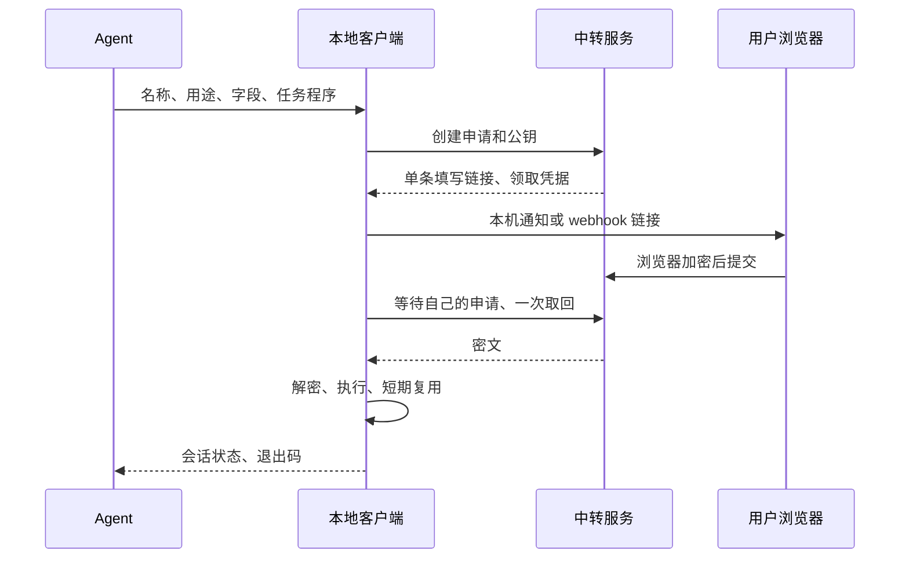

# Secret Request 0.3

Agent 匿名发起申请，用户点击通知在网页填写，客户端取回密文并在本地交给任务程序。支持 Windows、macOS 本机通知和客户端 webhook。应用按需运行；同一份程序可以连接自部署服务或受信任的共享服务。无需账号、设备登记、配对码或长期接入 token。



## 安装客户端

使用端支持标准的 [`npx skills`](https://github.com/vercel-labs/skills) 分发。完整 skill 位于 `skills/secret-request`，包含客户端、安装器及通知组件；服务端仍独立部署。

从 GitHub 安装，按提示选择 Agent：

```powershell
npx skills add zhaoxinbeizhucele/secret-request -g
```

也可以直接指定 Codex 或 Claude Code：

```sh
npx skills add zhaoxinbeizhucele/secret-request --skill secret-request -g -a codex -y
npx skills add zhaoxinbeizhucele/secret-request --skill secret-request -g -a claude-code -y
```

也可以用 `-a codex claude-code` 同时安装到两者。需要项目内安装时省略 `-g`，需要独立副本时加 `--copy`。本地开发可将来源替换为 `./`；Windows 的本地来源使用 `/`，例如 `./skills`，不要把 `.\skills` 误当成 Git 来源。

`npx skills` 安装 skill 文件，不执行应用安装脚本。安装后在新会话告诉 Agent：“初始化 secret-request，服务地址是 https://your-relay.example，使用本机通知。”Agent 根据 [安装指引](skills/secret-request/references/setup.md) 建立独立运行环境、自动生成配置并检查服务连接；不知道地址时应只询问服务 URL。需要 Node.js 22.20+ 运行当前 Skills CLI、Python 3.12+ 运行客户端。使用端无需 Docker，也不用取得任何管理员配置文件。

也可以手动初始化。以下 `<skill目录>` 指当前安装的 skill 位置；将示例 URL 换成自己部署或选择的可信服务地址：

Windows：

```powershell
python -I "<skill目录>\scripts\install.py" --url "https://your-relay.example"
& "$env:LOCALAPPDATA\Programs\SecretRequest\secret-request.cmd" --check-service
```

macOS / Linux：

```sh
python3 -I '<skill目录>/scripts/install.py' --url 'https://your-relay.example'
~/.local/share/secret-request/secret-request --check-service
```

安装器建立独立 Python 环境和命令入口，按 URL 自动生成配置并限制文件读取权限。同一服务可重复初始化，已有通知设置会保留；已有配置时可省略 `--url`，不同服务地址会报错并保留原配置。`--check-service` 只检查连接和匿名接入兼容性，不创建申请或发送通知。需要短命令时自行把入口目录加入 PATH。Windows 分发包携带已构建的通知组件，目标机无需 .NET；macOS 安装本机通知组件需 Apple Command Line Tools，再执行安装器的 `--build-notifier`。只有 webhook 时不必构建本机组件。Linux 使用 webhook，本机通知暂未实现。

更新 skill 用 `npx skills update`，然后运行其安装器更新依赖和入口，服务地址与通知设置继续沿用。用户自行打包后也可解压 `artifacts/secret-request-client.zip` 安装；分发包不包含用户配置。当前 Windows 组件使解压体积超过 Skills CLI 的直接下载默认上限，`npx skills` 分发采用 Git 或本地目录来源。

本项目安装器不修改全局 `AGENTS.md`、`CLAUDE.md` 或其他 Agent 指令。技能的触发描述要求 Agent 在已授权任务确实缺少机密时主动发起网页申请，无需用户点名；已有可用认证或有效会话则优先复用。新安装或更新后需让宿主重新加载技能（通常开启新会话）。主动选择仍取决于宿主的技能发现与调用能力，不是安装后拦截所有认证请求的后台功能。

GitHub 提供客户端和服务端源码，不预设一个面向公众开放的官方服务。服务地址由部署者提供；私网服务仍需处于对应网络才能连接。

开发者可运行 `python scripts/build_native.py` 构建当前系统组件；Windows 构建需要 .NET 10 SDK。通知组件没有菜单、托盘或开机启动项，Windows 发送后退出；macOS 等待本条通知点击或到期，申请结束时客户端会回收它。

## 客户端配置

初始化会自动生成 `~/.config/secret-request/client.json`。只使用本机通知时，只需服务 URL。需要 webhook 时，可以让安装器引用已有的环境变量，例如增加 `--webhook-type wecom --webhook-env SECRET_REQUEST_WEBHOOK`；仅用 webhook 时再加 `--no-local-notification`。以下是自动生成配置的结构示例，无需先准备这个文件：

```json
{
  "url":"https://your-relay.example",
  "notifications":{
    "local":true,
    "webhook":{
      "type":"wecom",
      "url_env":"SECRET_REQUEST_WEBHOOK"
    }
  }
}
```

企微的环境变量值是群机器人的完整 webhook 地址，属于敏感配置，不进入聊天或仓库。也可以在受保护配置中使用 `url`；`url` 和 `url_env` 二选一。本机通知与 webhook 可同时开启，默认启用本机通知。

通用 webhook 使用 `type: generic`，可附带 `headers`，接收 JSON：`event`、`request_id`、`title`、`message`、`input_url`、`expires_in_seconds`。它是约定格式，不承诺兼容任意消息平台。客户端只发送填写链接，不发送领取凭据、公钥或用户输入；中转服务不保存或调用 webhook。发送失败最多重试一次，始终使用同一条申请和链接。

Windows / macOS 需要登录桌面并允许通知。macOS 首次运行可能询问权限。没有桌面、通知被禁止或组件未安装时，渠道报告 failed/unsupported；配置 webhook 或明确使用 `--show-link` 取得备用填写链接。接收到消息不代表用户已经看到或处理。

## 使用

先准备并检查任务程序，再申请。多字段定义只含非敏感的 ID、标签、类型和必填标记：

```json
[
  {"id":"username","label":"用户名","type":"text"},
  {"id":"password","label":"密码","type":"password"}
]
```

```sh
secret-request --agent-name Codex --name "测试库登录" --purpose "查询已授权测试库结构" --fields-file fields.json -- python query.py
```

1–16 个字段，类型支持 text、password、textarea、email、url，required 默认 true。整个 JSON 对象经 stdin 或一个指定的环境变量交给程序。单字段不指定 fields-file 时收到原始字符串。stdin 为 UTF-8，无额外换行；内容上限 64 KiB。指定 `--env NAME` 会放入子进程环境，父进程环境不变。

客户端只等待本次申请，默认 600 秒，`--wait` 可设 10–1800 秒。等待期间报告通知渠道状态。用户可以提交或拒绝，终态不能再次填写。浏览器先加密、清空输入，服务确认提交后尝试关闭页面；禁止自动关闭时显示手动关闭提示。断网重试复用加密数据，不提前关闭。

解密后默认创建可复用会话，输出句柄，再执行任务。程序 stdout/stderr 不回传给 Agent；退出码和必要的非敏感业务结果用于判断成功。`--execution-timeout` 默认 300 秒，允许 1–3600 秒；程序结束、超时、撤销时清理其进程组/Windows Job，不用于启动常驻服务。

```sh
secret-request --use-session '<handle>' -- python query.py
secret-request --session-status '<handle>'
secret-request --session-status '<handle>' --execution-id '<本次execution_id>'
secret-request --revoke-session '<handle>'
```

会话默认空闲 5 分钟过期，`--session-ttl` 可设 10–1800 秒。合法执行运行中不因空闲过期，执行结束后重新计时；状态查询、无效、重复、busy 调用不续期。运行中 status 的 expires_at 和 remaining_seconds 为 null。首次工作目录、输入方式固定，最多一次并发执行；复用不再发送通知或申请。任务完成后应主动撤销。`--one-shot` 不创建复用后台。

主动 Ctrl+C 请求停止本次执行并撤销本次使用的会话，其他会话不受影响。事件中的 `execution` 表达真实执行结果，`session_state` 表达会话状态；任务已完成时保留原退出码，不因随后中断改报取消。确认中止只表示执行停止，已发生的副作用未回滚。未知状态提供同一句柄/执行 ID 的查询、撤销参数，不自动重跑。非主动断线保留原恢复能力；指定 ID 查询不会用上次结果替代本次结果。带 ID 的撤销最多保留 60 秒无机密结果回执，机密已不可复用；回执到期/后台退出后不能恢复执行结果。

POSIX 清理范围是受控进程组，脱离该组的后代不在保证内；Windows 使用 Job Object。它们不构成任意任务程序的安全隔离。

每个用户最多 16 个机密会话后台，用操作系统锁限制，无凭据或句柄文件。每个会话最多 256 次执行。随机句柄有使用权限，不能分享；固定目录不是沙箱。断线后先核对执行 ID 和业务结果，不自动重复未知结果的写操作。重启电脑或会话后台退出后机密无法恢复。

## 部署中转服务

安装 `requirements.txt` 中依赖。生成新配置时必须使用不存在的输出目录，脚本拒绝覆盖和隐式轮换：

```sh
python scripts/provision.py --url https://your-relay.example --output runtime
docker compose -f deploy/compose.yaml up -d --build relay
```

脚本只生成服务端 `relay.json`，最小内容为 `{"base_url":"https://your-relay.example"}`。把 URL 提供给使用者即可，无需生成或分发设备凭据。Docker 仅绑定 127.0.0.1:8787；用可信 HTTPS 反向代理或 Tailscale Serve 暴露，并使配置 base_url 与实际浏览器入口一致。公开源码不会自动部署中转服务，也不会改变现有服务的访问范围。

服务只支持单 worker。密文及申请存在内存，不建历史数据库；重启使未交付申请失效，但已取回的本机会话不依赖服务。默认最多 128 条在途申请；同一来源 IP 最多 8 条、每分钟创建 20 条，服务整体每分钟最多创建 120 条。对应设置为 `max_requests`、`max_requests_per_ip`、`requests_per_minute`、`global_requests_per_minute`。已结束元数据在申请截止时间后 10 分钟删除，总量及限流记录也有限制。

默认部署不信任转发头，按实际连接来源限流；经过反向代理时，使用者可能共享代理的限额。部署者可在可信入口额外按真实客户端 IP 限流，不要直接信任公网传来的 X-Forwarded-For。来源地址仅以随机盐哈希暂存在进程中，不展示给填写者；匿名指无需账号与设备登记，不代表隐藏网络地址。

本版无登录、配对和全局列表。任何能连接服务的客户端都可以创建申请；填写/拒绝与状态/取消/领取使用互相独立的单条随机凭据。服务只保留其哈希，不提供申请枚举入口。Agent 名称由申请方声明，不代表验证过身份。填写链接持有者有处理权限：发到群里意味着群成员也可以填写或拒绝，不能据此领取输入。领取为一次性，响应丢失不能再次领取，应核对后重新申请。

浏览器采用 RSA-OAEP/SHA-256 包装 AES-256-GCM 密钥并绑定请求 ID；私钥留在发起电脑。正常服务只拿到密文。用户仍需信任提供网页的服务：被篡改的网页可以在加密前访问输入；本机完整权限的程序也不受隔离。工具不长期保存输入，但不能承诺擦除所有内存、交换文件或转储副本。

## 开发与打包

```sh
python -m pytest -q
python scripts/build_skill.py
python scripts/package_client.py
python scripts/package_deploy.py
```

客户端变更后重新生成 skill 再分发。服务器包排除配置、测试端点和本机通知二进制。验证范围和人工验收见 [TEST-REPORT.md](TEST-REPORT.md)。

0.2 升级到 0.3：先备份服务配置，移除 `clients`，把 `max_requests_per_client` 改为 `max_requests_per_ip`（如曾设置），然后更新并重启服务。此后所有能连接服务的客户端均可匿名创建申请；旧未完成申请会随重启失效。客户端更新 skill 后运行安装器，会保留服务地址和通知设置并移除旧 `request_token`，无需重新获取文件。0.3 客户端不能连接仍要求设备凭据的 0.2 服务，`--check-service` 会提示升级。旧 reviewer、ntfy、全局列表、托盘、开机启动项和历史数据库均已退役。
